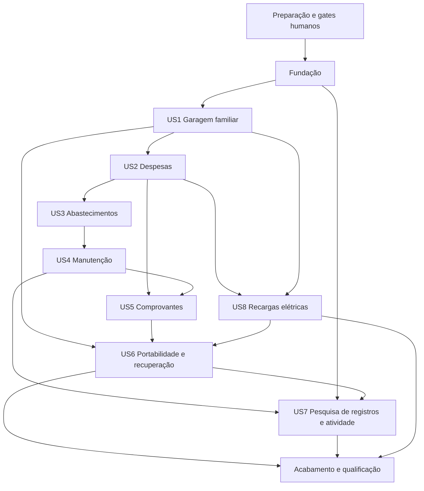

# Tarefas: Garagem pessoal e familiar

**Entrada**: Documentos em `specs/001-garagem-pessoal/`.
**Pré-requisitos**: [spec](spec.md), [plano](plan.md), [pesquisa](research.md), [modelo](data-model.md), [OpenAPI](contracts/openapi.json), [schemas tipados](contracts/resources.schema.json), [regras HTTP/mobile](contracts/api.md) e [quickstart](quickstart.md).
**Origem**: IA assistida. **Revisor humano**: CEO da Altivy e owner do GarageMotor.
**Estado**: execução da feature autorizada pelo owner em 2026-11-09; tarefas são marcadas somente após validação executada.
**Seleção explícita**: `SPECIFY_FEATURE_DIRECTORY=specs/001-garagem-pessoal`.
**Revisão**: 2026-11-10; tarefas sincronizadas com os esclarecimentos, US7/US8 e desenho PostgreSQL nativo. 82 tarefas; T001–T010, T012, T014–T017 concluídas; T011 e T013 aguardam validação funcional; outras tarefas permanecem conforme seus gates.

**Esclarecimentos humanos de 2026-11-11**: o owner declarou aceite dos termos SDK fixados, mínimo Android 15/API35, `appId`/`applicationId` `it.altivy.garagemotor` e guarda da chave de assinatura no vault corporativo com acesso seguro pelo GitHub, conforme `spec.md`, Session 2026-11-11. As opções informadas são Azure Key Vault ou 1Password via `op`; backend definitivo e integração permanecem a definir. Nenhum secret deve ser solicitado pela conversa ou versionado. Não marcar tarefa Android como concluída por esse aceite. O recorte web da T067 foi autorizado separadamente nesta conversa; não implica publicar, executar deploy ou aceitar outros contratos.

**Execução parcial autorizada da T067 — 2026-11-11**: após a autorização do recorte web e o pedido "Entendido, siga com o plano", foram criados `deploy/Dockerfile.api`, `deploy/Dockerfile.web`, `deploy/nginx.web.conf` e `docs/install.md`; Compose/launcher foram conectados às bases fixadas do lock e aos comandos corretos. Builds de desenvolvimento/runtime passaram; API sem configuração recusou iniciar no guard esperado; smokes HTTP de marca passaram 6/6 em cada imagem web pela borda nginx. `quality` oficial passou; arquivos OpenAPI/schema estão juntos no pacote e runtimes sem root. O perfil integrado agora retorna `blocked`, exit 2, por arquivo externo ausente, sem leitura de conteúdo, e rejeita caminho alternativo. Nenhuma credencial foi criada nem volume existente alterado. T067 permanece desmarcada: configuração/banco real, instalação integrada, pacote local completo e Android ainda não foram validados. Evidências e instruções em `docs/install.md`.

**Restrição humana posterior e adaptação compartilhada — 2026-11-11**: o owner declarou "Pode criar a pasta/arquivos em ~/.microsoft/usersecrets/GarageMotor/ porém, use a instancia do postgres ja existente, assim como o nginx ja existente" e indicou os scripts Dokpod/architecture-knowledge-base. O Compose foi reduzido a API/web, sem serviço PostgreSQL/nginx, volume de banco ou portas publicadas, com redes externas e aliases próprios; o launcher verifica essas redes e a parada não usa credenciais nem remove órfãos/redes externas. YAML e scripts ficaram sem diagnósticos; `compose config --services` confirmou somente `api` e `web`. O preflight recusou iniciar porque `identity-global` não existe no contexto atual; `identity-client` também não aparece na listagem. A CLI Docker e outros contextos Podman não estão disponíveis aqui. A pasta externa foi criada com modo 0700, sem arquivo `.env` ou credencial gerados. Nenhum container, rede, rota, banco ou volume compartilhado foi criado ou modificado. Falta identificar os serviços/contexto/origem pública antes de escrever connection strings ou executar provisionamento; T067 continua parcial e desmarcada.

**Retomada com Podman rootless — 2026-11-11**: por determinação expressa do owner ("Use sempre podman rootless"), `start-local.ps1`, `stop-local.ps1` e `validate-feature.ps1` aceitam somente Podman e verificam rootless antes de operar. Sintaxe/allowlist e engine rootless foram validadas; `web-e2e` continua bloqueando por configuração GarageMotor ausente, sem iniciar serviços. O bootstrap Identity foi conferido pela cópia local dos exemplos: o arquivo externo da Identity existe, mas a interpolação suportada pelo provider falha em mounts com sintaxe Windows, detectada sem emitir valores. A tentativa inicial com `--quiet` foi descartada como opção não suportada, não evidência de configuração inválida. A leitura remota pública retornou 404 e a ferramenta autenticada exigiu login; não se presume que a cópia local seja a última versão remota. Não houve start da Identity, leitura direta/cópia de secrets, mudança de configuração privada ou manipulação dos dados existentes. T067 permanece pendente até confirmar caminhos Linux e reutilização segura do volume/certificados/temas.

## Formato: `[ID] [P?] [Story] Descrição`

**Primeiro bootstrap compartilhado autorizado — 2026-11-11**: o owner esclareceu que a máquina é nova e a stack Identity nunca foi executada, autorizando inicializar a estrutura sob `~/.microsoft/usersecrets/Altivy.Identity`. Foi implementado `tools/scripts/start-shared-identity.ps1`, com adaptador Compose público Linux separado, imagens fixadas por digest e sem ler/sobrescrever diretamente o `.env` existente. O provider não respeitou overrides de mounts Windows no manifest original; o adaptador declara paths Linux explicitamente, preservando projeto `altivy-identity` e redes compartilhadas. O diretório de dados estava ausente; foram criados o cluster inicial e schema `identity` via `deploy/identity-init.sql`, aguardando saúde PostgreSQL antes de Keycloak/gateway. `altivy-identity-postgres`, `altivy-identity-keycloak` e `altivy-identity-gateway` estão ativos em Podman rootless; PostgreSQL/Keycloak saudáveis. Discovery OIDC master retornou 200 por `https://localhost:7443`, validando cadeia/hostname com a CA pública existente `certs/rootCA.pem`; a chave privada não foi montada no runner e não houve bypass TLS. Certificados e `.env` anteriores foram preservados, assim como containers de outros projetos. Rejeição de modos conflitantes e de bootstrap duplicado passou. T067 permanece parcial: a plataforma está pronta, mas configuração própria, banco/roles, rota e sessão real do GarageMotor ainda dependem da integração do produto. Operação e limites em `docs/install.md`.

**Integração real do recorte web da T067 — 2026-11-11**: após o pedido humano de continuidade, o provisionador criou exclusivamente a configuração externa (pasta 0700/arquivo 0600), banco e roles próprias no PostgreSQL compartilhado, com migration aplicada e sem superuser/BYPASSRLS. A rota `/garagemotor/` foi instalada no nginx existente após `nginx -t`; TLS/cadeia/hostname e discovery Identity preservados. API confia somente no IP do gateway e persiste o key ring cifrado em volume privado. O perfil oficial `web-e2e` passou com quatro testes estáticos de contratos e duas jornadas reais desktop/móvel: cadastro/login, cookies seguros, temas, CSRF, dez códigos offline e logout. Corrigido o cliente para exigir CSRF no DELETE de sessão e o launcher para recriar containers após build. `quality` oficial e dois testes unitários passaram; ciclo parar/iniciar preservou volumes. Nenhum secret foi impresso, lido de arquivo existente ou copiado para o runner Playwright. Evidências, comandos e limites em `docs/install.md`. T067 continua parcial e desmarcada: não inclui SMTP, sessão restaurada após reload, matriz completa, Android, pacote completo ou publicação; os perfis .NET integration/load ainda precisam de alinhamento próprio.

**Execução parcial autorizada da T011 — 2026-11-13**: a correção das respostas OpenAPI por operação foi [verificada](../../.specify/bugs/openapi-tipos-operacao/test.md); os oito testes de contrato passaram na origem e nos JSON extraídos da imagem reconstruída. Pelo nginx isolado, passaram os quatro testes focados de acessibilidade e 14 testes de primitivas/acessibilidade. Na suíte ampliada, 34 de 36 passaram: dois testes de marca preexistentes atingiram timeout ao tentar selecionar `Escuro` oculto; seus arquivos não foram alterados nesta tarefa. O schema de membro aceitou exemplos com `id` e `attributes.userId` diferentes; os endpoints e o store de membros das T023/T025 ainda não existem, portanto a correspondência com `user_id` e o parâmetro da rota não foi comprovada. A T011 continua desmarcada; nenhum deploy ou publicação foi realizado.

IDs são sequenciais; `[P]` identifica arquivos distintos e ausência de dependência mútua depois dos gates da fase. `[US1]`–`[US8]` relacionam tarefas às histórias. Referências FR/SC indicam rastreabilidade, não evidência de execução. Marcar checkbox somente após validação executada, nunca como aprovação humana.

## Convenções de Caminhos

Usar a estrutura enxuta do plano: `backend/GarageMotor.Api/`, `backend/GarageMotor.Tests/`, `frontend/web/`, `frontend/tests/`, `deploy/`, `tools/scripts/` e `docs/`. Os caminhos abaixo são destinos de implementação futura, não arquivos já existentes. Não criar scripts próprios em `.specify/` nem copiar agentes, Keycloak, terminal ou Business do Dokpod.

## Fase 1: Preparação (Infraestrutura Compartilhada)

**Objetivo**: registrar os gates humanos e preparar código, contratos e ferramentas auditados.
**Bloqueio**: antes de executar qualquer tarefa, concluir `/speckit-analyze` e obter autorização humana explícita sobre diretório, tarefas e escopo. Nenhuma tarefa autoriza push, publicação, release ou aceite automático de termos.

- [X] T001 Registrar aprovação humana do ADR de datastore em `docs/adr/2026-0001-persistencia-garagem.md` e gates de segurança, riscos e evidências pendentes em `docs/security-review.md`; ADR aceito somente com decisão explícita do owner; aceite é pré-requisito para migrations/testes com banco em T012–T015 e US1–US8, não para preparação estática de manifests.
- [X] T002 Formalizar texto oficial AGPL-3.0-only em `LICENSE` (idêntico à cópia oficial local), criar avisos em `NOTICE.md` e reconciliar a referência MIT em `.github/copilot-instructions.md`/`README.md`, preservando terceiros e a exceção restrita Android; Groundwork consultado, sem alterar templates ou procedimentos gerenciados.
- [X] T003 Criar baseline de versões/licenças/origem em `docs/dependencies.md`, `global.json`, `backend/Directory.Packages.props`, `backend/GarageMotor.Api/GarageMotor.Api.csproj`, `backend/GarageMotor.Tests/GarageMotor.Tests.csproj` e `frontend/web/package.json`; fixar SDK10.0.403/runtime10.0.14, Npgsql10.0.3, MSTest4.5.2, Angular22.2.5/CLI-build22.2.6, TS6.0.3/Node24.22.2, Capacitor8.6.0, Playwright1.65.0 e Prettier3.9.10; declarar manifests sem restaurar, executar código de dependências ou ler secrets. Guardar as referências de licença/contribuições e aplicar source mapping; revisão de lockfiles transitivos fica após T005. Validação estrutural aprovada; T003 não executou restore/install/build. A resolução e instalação posteriores estão registradas em T005.
- [X] T004 Fixar manifests de imagens/termos/checksums em `deploy/images.lock.json` e `docs/android-toolchain.md`: PostgreSQL 18.6/nginx 1.30.6; JDK 21.0.13+9, Gradle 8.14.3, AGP 8.13.0 e Android build-tools 36.0.0; obter aceites humanos necessários antes de uso; nenhuma ferramenta Android no host ou distribuída no app. Metadados e formatos de checksum validados sem baixar imagens ou ferramentas; aceite Android continua pendente e bloqueia o uso.
- [X] T005 Criar o esqueleto dos projetos .NET em `backend/GarageMotor.Api/GarageMotor.Api.csproj` e `backend/GarageMotor.Tests/GarageMotor.Tests.csproj`, SPA em `frontend/web/angular.json`/`frontend/web/tsconfig.json` e lockfiles NuGet ao lado de cada csproj mais `frontend/web/package-lock.json`; após T001–T004, resolver em container isolado sem secrets, sem scripts npm de terceiros e sem build da aplicação, auditar transitivas/avisos/hashes e falhar fechado antes de build/test para dependências com licença ausente/restritiva, exceto os quatro artefatos/versões explicitamente aprovados nas constituições 1.2.0/1.3.0 e somente no escopo nelas descrito. Não exigir lock final antes dos manifests; não aceitar termos automaticamente. Sem ORM/mediator/framework UI adicional. `angular.json`/`tsconfig.json` criados; `npm ci --ignore-scripts` e `npm ls --depth=0` passaram no runner fixado; NuGet `--locked-mode` passou para API/testes. Nenhum script lifecycle, build ou teste executado. A licença de CodeCoverage segue não verificada; inventários SPDX de imagem por digest/plataforma registrados em `deploy/sboms/`, com limites descritos em `docs/dependencies.md`.
- [X] T006 Configurar formatador/analyzers e compilação estrita em `backend/Directory.Build.props`, `.editorconfig` e `frontend/web/.prettierrc.json`; preservar arquivos fora do escopo e expor verificações pelo runner de qualidade em containers. Configurações e `.prettierignore` validados estruturalmente; T008 conectará e executará o quality profile em container. Nenhum build/análise de código foi executado.
- [X] T007 Preparar `deploy/compose.yaml`, `deploy/nginx.conf` e `tools/scripts/start-local.ps1`/`stop-local.ps1`: API, web, banco e volume privados, somente nginx como borda HTTP; encaminhar também preview Angular pelo proxy; passar apenas caminho externo de secrets, sem copiar/exibir conteúdo; parada não remove volumes implicitamente. YAML Compose aceito pelo provider Podman 1.0.6 e scripts passam análise sintática; nenhum serviço foi iniciado. Start falha fechado até a criação dos Dockerfiles em T067; stop não remove volumes.
- [X] T008 Preparar runners e fixtures fictícias em `tools/scripts/validate-feature.ps1`, `backend/GarageMotor.Tests/Fixtures/RealEnvironment.cs` e `frontend/tests/playwright.config.ts`; perfis quality/unit/integration/web-e2e/android/load/restore, exit codes e resumos sanitizados; banco/filesystem reais, HTTP pelo nginx e unit sem nginx ocioso. Parser PowerShell, diagnósticos C# e config Playwright sem erros; preflight quality retorna bloqueio 2 por fontes Angular ausentes, sem iniciar containers. Nenhum perfil de build/teste/HTTP foi executado.

**Checkpoint**: somente após inventário, termos, autorização e estrutura validados, iniciar a fundação. T001 não é aprovação delegada à IA; T003/T004 não se concluem por citar licença primária no plano.

## Fase 2: Fundação (Pré-requisitos Bloqueadores)

**Objetivo**: identidade, contexto de garagem, transações, partições, erros e primitivas UI.
**CRÍTICO**: nenhuma história de usuário pode começar antes da conclusão desta fase.

- [X] T009 [P] Escrever testes de fundação em `backend/GarageMotor.Tests/Foundation/SecurityTests.cs` para sessão/revogação, CSRF/origem, respostas genéricas, OTP SMTP15min, códigos offline únicos10/12meses, cinco falhas por conta15min, teto por origem configurável e concorrência de contadores; cobrir o valor operacional proposto de 100 falhas/origem/15min sem tratá-lo como decisão humana, ausência de secrets e sem mocks como evidência de persistência.
- [X] T010 [P] Escrever testes PostgreSQL/arquivo de base em `backend/GarageMotor.Tests/Foundation/PersistenceTests.cs`: transações, dois contextos sintéticos de garagem, conexões pooled, RLS, role sem BYPASSRLS, idempotência de criação scoped por ator antes de existir garage_id, lock/rollover e índices/default; banco/filesystem reais, sem depender das entidades ainda não criadas em US1; membership/recibos reais revalidados nas histórias.
- [ ] T011 [P] Escrever validação de contrato em `frontend/tests/contracts/openapi.spec.ts` e teclado/foco/estados do DS em `frontend/tests/design-system.spec.ts`: validar OpenAPI e resolução do `$ref` externo `resources.schema.json` também no pacote que publica a descrição da API, oneOf/kind por operationId, additionalProperties=false, nulabilidade, campos privados proibidos, formatos UUID de `MemberResource.id`, `attributes.userId` e path member `{id}` sem alegar que validação estrutural comprova sua igualdade, 14 resources, 12 criações com Idempotency-Key, entradas discriminadas de recarga e AuditSearchItem fechado com owner-only; não relaxar o contrato para acomodar handler incompleto. A correspondência funcional com `user_id` será coberta por T021/T027 após a implementação de T023/T025.
- [X] T012 Implementar infraestrutura SQL/transações/migrations expand-contract em `backend/GarageMotor.Api/Infrastructure/Database.cs` e iniciar `backend/GarageMotor.Api/Migrations/001_identity_and_operations.sql` com o schema de identidade: UUID/version positiva, datas UTC, role runtime sem superuser/BYPASSRLS, SET LOCAL por transação e role migrations separada; aplicar RLS às tabelas de domínio quando criadas. T014 estende esta mesma migration sequencialmente; aplicar somente após ambos os trechos estarem integrados e revisados. Build sem warnings; migration executada duas vezes em PostgreSQL 18.6 real; roles runtime/migration verificadas sem superuser/BYPASSRLS. Testes automatizados de persistência não foram executados porque a API ainda não tem entry point (T020).
- [ ] T013 Implementar preparação/rollover em `backend/GarageMotor.Api/Infrastructure/PartitionManager.cs`: partições mensais, doze meses anteriores/três futuros/default, job diário, migração transacional do default antes de attach e índices por filho, incluindo GIN de busca nas partições existentes/futuras/default; não presumir unicidade/FK global entre partições; fundação expõe mecanismo, migrations das entidades pertencem às histórias.
- [X] T014 Implementar recibos transacionais em `backend/GarageMotor.Api/Operations/OperationStore.cs` e estender sequencialmente a migration `backend/GarageMotor.Api/Migrations/001_identity_and_operations.sql`, iniciada em T012, sem edição concorrente do arquivo: operation_key UUID, operation_name, actor_id, scope_kind/scope_id, garage_id nullable antes da criação inicial, request_hash, status pending/succeeded, resource_id e resposta pública mínima; lock/lookup antes da mutação, garagem no escopo actor+actor_id sem garage_id prévio e recursos filhos no escopo garage validado; chave/contexto/conteúdo idênticos retornam status/id/version anteriores, operação/conteúdo divergentes retornam 409, criação+recibo commitam juntos, replay reautoriza e não contém tokens; cobrir as 12 criações FR-013 e If-Match inteiro positivo.
- [X] T015 Implementar auditoria e contratos de falha em `backend/GarageMotor.Api/Operations/AuditStore.cs` e `backend/GarageMotor.Api/Infrastructure/ProblemResponses.cs`: 90 dias, partições mensais, actor pseudônimo/campos alterados mínimos e traceId, sem valores/documentos/tokens/logs integrais; preparar somente action/actor pseudonimizado/target/nomes de changed_fields para busca de auditoria owner-only; problem+json para 400/401/403/404/409/413/415/422/429/503 e sem enumeração cruzada. `AuditTests` passou 2/2 em PostgreSQL real; RLS isolou garagens, schema não contém valores alterados e a role migration removeu eventos >90 dias; respostas `problem+json` validadas.
- [X] T016 Implementar modelos/stores de identidade e tentativas em `backend/GarageMotor.Api/Identity/IdentityStore.cs` e `backend/GarageMotor.Api/Identity/RecoveryAttemptStore.cs`: email normalizado até254/nome até100, password_hash pelo framework, sessão opaca >=256bits com apenas hash persistido e expiração12h; código 16 bytes via RNG do framework/base64url22, somente hash/tempo constante, RecoveryBatch de exatamente10 códigos e expiração12meses, SMTP15min, uso/revogação/auditoria e RecoveryAttempt por identidade normalizada/origem sem PII plaintext; cinco falhas/conta/janela móvel15min e teto de origem configurável, concorrente e expirável. 100/origem/15min é proposta técnica, sujeita à revisão humana de segurança em T001/T079, não decisão humana; preservar o limite confirmado por conta. Sem algoritmo criptográfico próprio/bloqueio permanente.
- [X] T017 Implementar endpoints/middleware em `backend/GarageMotor.Api/Identity/IdentityEndpoints.cs`: registerAccount/createSession/revokeSession/getCsrfToken/requestRecovery/confirmRecovery/renewOfflineRecoveryCodes; senha12–128, cookie web Secure/HttpOnly/Path=/, antiforgery/CORS/rate limit/bearer Android, respostas genéricas 422/429, lote offline único revelado após reautenticação com expiresUtc e Cache-Control no-store; renovar invalida lote anterior e recuperação bem-sucedida troca senha/consome código/revoga todas as sessões e outros códigos numa transação, sem revelar conta.
- [ ] T018 Implementar proteção/configuração em `backend/GarageMotor.Api/Infrastructure/SecurityConfiguration.cs`, `frontend/web/src/app/core/session.ts` e telas em `frontend/web/src/app/features/auth/`: cadastro/login/logout/recuperação, códigos offline somente após reautenticação, chaves do framework protegidas por credencial externa em volume privado, nenhum segredo plaintext no repo/exportação, token web fora do JavaScript, estado Android em memória até Keystore de US6; nenhum localStorage de token.
- [ ] T019 Implementar shell/tokens/primitivas necessárias em `frontend/web/src/app/design-system/` e `frontend/web/src/styles/`: usar referência Altivy/Dokpod autorizada, Outfit com avisos próprios, painéis densos opacos, foco/teclado/status texto-ícone/motion reduzido; sem importar Business, Ionic UI, axe-core ou biblioteca não auditada. As exceções nominais de lightningcss 1.33.0 e lightningcss-linux-x64-gnu 1.33.0 são somente para build/teste e não permitem uso no runtime ou como biblioteca de UI.
- [ ] T020 Integrar infraestrutura, autenticação e informações públicas em `backend/GarageMotor.Api/Program.cs`, `backend/GarageMotor.Api/Operations/InstanceEndpoints.cs` e `frontend/web/src/app/core/api-client.ts`: base /api/v1, getInstance major1, requests tipados, erros recuperáveis, cabeçalhos e indicadores como strings decimais; validar T009–T011 e perfis unit/integration/quality.

**Checkpoint**: T009–T020 validadas com backend real, contratos, contexto e UI de base. A membership específica será implementada em US1; nenhuma história pode contorná-la usando mocks ou identidade administrativa global.

## Fase 3: História de Usuário 1 - Garagem familiar (Prioridade: P1) MVP

**Objetivo**: garagem, veículos, compartilhamento e isolamento.
**Teste independente**: duas garagens com veículos, convite/papéis/revogação e último owner protegido, sem despesas.

### Testes da História de Usuário 1

- [ ] T021 [P] [US1] Escrever testes FR-002–FR-005/FR-013/SC-003–SC-004 em `backend/GarageMotor.Tests/Garages/GarageTests.cs` antes da implementação e confirmar que falham: convites72h/uso único/email correspondente, papéis, transferência, recurso cruzado404, veículo arquivado, replay createGarage antes de existir garage_id, createVehicle/createInvite repetidos, resposta inacessível após revogar membership e correspondência entre `MemberResource.id`, `attributes.userId`, `Member.user_id` e `{id}` na alteração/revogação do membro correto.
- [ ] T022 [P] [US1] Testar jornada inicial e teclado em `frontend/tests/garage.spec.ts`: login, criação/seleção de garagem, convite/aceite/papéis e cadastro/arquivo de carro/moto; anexar screenshots desktop/mobile e confirmar falha antes da UI.

### Implementação da História de Usuário 1

- [ ] T023 [US1] Criar modelos/migration/store em `backend/GarageMotor.Api/Garages/GarageStore.cs` e `backend/GarageMotor.Api/Migrations/002_garages_vehicles.sql`: Garage name1–100/fuso IANA America/Sao_Paulo/active-deleting; Member owner-editor-reader/active-revoked com chave natural única `(garage_id,user_id)`; o UUID `MemberResource.id` e o parâmetro path `{id}` representam `Member.user_id`, sem surrogate id adicional; Invite email até254/role editor-reader/pending-accepted-revoked-expired/hash/72h; OperationReceipt actor-scoped para garage e garage-scoped para recursos, `garage_id` nullable apenas no recibo inicial, version e owner único/transferência atômica.
- [ ] T024 [US1] Implementar veículo em `backend/GarageMotor.Api/Vehicles/VehicleStore.cs`: label/brand/model1–100, car/motorcycle, year1900–ano atual+1, fuel gasoline-ethanol-diesel-flex-electric-other, plate opcional até10/renavam opcional11dígitos/chassis opcional até17, active/archived; createVehicle usa recibo transacional por ator/garagem/chave/conteúdo, replay devolve versão original após reautorizar membership; arquivar preserva histórico e recusa novos registros.
- [ ] T025 [US1] Implementar `backend/GarageMotor.Api/Garages/GarageEndpoints.cs` e `backend/GarageMotor.Api/Vehicles/VehicleEndpoints.cs`: create/list/get/updateGarage, members/roles/revogação/ownership/invites/aceite e create/list/get/updateVehicle; createGarage sem garagem prévia usa scope ator e mesmo ator/chave/operação/hash; createInvite também idempotente; respostas em Garage/Member/Invite/VehicleResource fechado de `contracts/resources.schema.json`; `MemberResource.id` e `{id}` das rotas de membro correspondem a `user_id`; membership por operação, RLS/contexto de garagem e If-Match; replay não retorna recurso após revogação.
- [ ] T026 [US1] Implementar telas e seleção em `frontend/web/src/app/features/garages/` e `frontend/web/src/app/features/vehicles/`, rotas/guards em `frontend/web/src/app/app.routes.ts`; aplicar pt-BR e states vazios/arquivados, validação e permissão sem expor outra garagem.
- [ ] T027 [US1] Validar T021–T026 pelos perfis de `tools/scripts/validate-feature.ps1`, registrando resultados sanitizados em `docs/verification/us1.md`; com PostgreSQL real e HTTP pela borda nginx, confirmar que `MemberResource.id` e `attributes.userId` correspondem ao `Member.user_id`, que `{id}` altera/revoga somente esse membro e que o isolamento entre garagens é preservado; reautorizar convites/replay/membership, teclado e fluxo; não marcar execução com base apenas em mocks ou screenshots.

**Checkpoint**: US1 entrega primeiro incremento demonstrável, mas não o MVP completo da spec.

## Fase 4: História de Usuário 2 - Despesas e custos (Prioridade: P1)

**Objetivo**: fonte única de despesas, totais corretos e cobertura explícita.
**Teste independente**: fixture US1 e três despesas; correção/anulação, totais e distância insuficiente.

### Testes da História de Usuário 2

- [ ] T028 [P] [US2] Testar FR-006–FR-009/FR-013/SC-002–SC-004 em `backend/GarageMotor.Tests/Expenses/ExpenseTests.cs`: centavos, transação, anulação, data/partição, conflito, repetição createExpense idêntica/divergente, recuperação do resultado após membership revogada sem revelar payload e custo/km incompleto sem distância.
- [ ] T029 [P] [US2] Testar tabela/filtros/registro/correção/anulação/totais em `frontend/tests/expenses.spec.ts`, incluindo estados vazios, leitor, formato pt-BR e cobertura parcial; usar dados autorizados pelo nginx.

### Implementação da História de Usuário 2

- [ ] T030 [US2] Criar entidade/migration/store em `backend/GarageMotor.Api/Expenses/ExpenseStore.cs` e `backend/GarageMotor.Api/Migrations/003_expenses.sql`: vehicle/garage/date obrigatórios, description1–500, amount_minor1–999.999.999.999 BRL, category fuel-maintenance-insurance-tax-other, origin manual-fuel-maintenance com vínculo opcional, active/voided e autoria/version; partição mensal spent_on, chave(id,spent_on,garage_id) e relações com mesma garagem.
- [ ] T031 [US2] Implementar contratos e agregação em `backend/GarageMotor.Api/Expenses/ExpenseEndpoints.cs` e `backend/GarageMotor.Api/Expenses/SummaryService.cs`: list/create/update/voidExpense/getSummary; createExpense idempotente em todas as repetições previstas; filtros inclusivos, cursor validado e resposta fechada `ExpenseResource`/`Summary`; coveredFrom/coveredTo/distanceKm/coveredExpenseMinor; decimal como string e sem duplicação; consumo indisponível até US3.
- [ ] T032 [US2] Implementar formulário/tabela/totais em `frontend/web/src/app/features/expenses/` e `frontend/web/src/app/features/dashboard/`, usando apenas DTOs públicos, filtros e permissões; não implementar fonte de despesas paralela ao contrato.
- [ ] T033 [US2] Validar T028–T032 em `docs/verification/us2.md` pelo runner, incluindo rollback de data financeira com referências e preservação de auditoria; medir a jornada inicial SC-001 em até cinco minutos com usuário preparado, sem presumir estudo de satisfação.

**Checkpoint**: despesas e totais são úteis mesmo sem consumo; indicadores incompletos não são apresentados como medição válida.

## Fase 5: História de Usuário 3 - Abastecimento e consumo (Prioridade: P1)

**Objetivo**: medição confiável e despesa de combustível única.
**Teste independente**: fixture US1 e sequência completa/parcial/corrigida de abastecimento.

### Testes da História de Usuário 3

- [ ] T034 [P] [US3] Testar FR-010–FR-013/SC-002–SC-004 em `backend/GarageMotor.Tests/Fuel/FuelTests.cs`: 100.000/100.550km e tanque final50L=11km/l, soma de parciais, combustíveis distintos, divisão zero, regressão/justificativa e recálculo.
- [ ] T035 [P] [US3] Testar criação/histórico/correção e repetição após reconexão em `frontend/tests/fuel.spec.ts`, sem duplicar valor/medição ou converter falta de fechamento em consumo completo.

### Implementação da História de Usuário 3

- [ ] T036 [US3] Implementar modelo/migration/store em `backend/GarageMotor.Api/Fuel/FuelStore.cs` e `backend/GarageMotor.Api/Migrations/004_fuel.sql`: odometer_km0–9.999.999, volume_ml1–1.000.000, fuel gasoline-ethanol-diesel-other, full_tank boolean, station opcional até200/historical_reason opcional até500, expense_id/date e active/voided/version; recibo por createFuelRecord; gravação/correção/anulação atômicas com US2 e partição mensal occurred_on.
- [ ] T037 [US3] Implementar `backend/GarageMotor.Api/Fuel/FuelEndpoints.cs` e `backend/GarageMotor.Api/Fuel/ConsumptionService.cs`: list/create/update/voidFuelRecord, replay idempotente com membership novamente validada, intervalos completos/parciais, combustível comparável e leitura válida; integração getSummary com DTO fechado; não substituir leitura recente por inclusão histórica silenciosa.
- [ ] T038 [US3] Implementar registro e histórico em `frontend/web/src/app/features/fuel/`, com tanque cheio, combustível, justificativa e cobertura; chave de operação estável/If-Match, limites em litros/km/BRL apresentados em pt-BR.
- [ ] T039 [US3] Validar T034–T038 com PostgreSQL real em `docs/verification/us3.md`, incluindo replay após rollover, conflito/recalculo e despesa única no dashboard; não marcar consumo correto por apenas comparar a aritmética do exemplo.

**Checkpoint**: fonte válida de odômetros/consumo, sem estimativa mecânica ou duplicação financeira.

## Fase 6: História de Usuário 8 - Registrar recargas de carros elétricos (Prioridade: P1)

**Objetivo**: registrar energia/custo, tarifas domésticas e eficiência elétrica sem misturar carga a combustível líquido.
**Dependências**: US1 para veículos elétricos e US2 para a despesa única; não depende do tipo ou tabela de abastecimento líquido de US3.
**Teste independente**: carro elétrico ativo, tarifa doméstica versionada, recargas públicas, duas sessões com bateria cheia e recarga parcial intermediária; conferir energia, custo, eficiência e repetição sem duplicação.

### Testes da História de Usuário 8

- [ ] T040 [P] [US8] Testar FR-013/FR-032/SC-002/SC-004/SC-010 em `backend/GarageMotor.Tests/Charging/ElectricChargeTests.cs` com PostgreSQL real: home/public, Wh→kWh, tarifa aplicável/snapshot e mudança sem reprecificação, roles owner/editor/reader, uma despesa por sessão registrada, idempotência, correção/anulação, R$ 0,01 para sessão pública sem cobrança e cálculo cheio-a-cheia incluindo parciais.
- [ ] T041 [US8] Testar jornada web em `frontend/tests/charging.spec.ts` com PostgreSQL real: cadastrar tarifa, registrar recarga doméstica/pública, reader não altera tarifa, sessão repetida não duplica, bateria cheia/parcial e estados de eficiência parcial/indisponível/completa; HTTP via nginx. A integração Android é qualificada em T061/T068 após o shell nativo de US6.

### Implementação da História de Usuário 8

- [ ] T042 [US8] Criar `backend/GarageMotor.Api/Migrations/008_electric_charging.sql` em expand-contract: estender a validação de `Expense.origin` para `electric_charge` sem remover origens existentes; criar ElectricityTariff por garage_id/effective_from com rate_minor_per_kwh e ElectricCharge particionada mensalmente por occurred_on, energy_wh inteiro, odometer_km, full_at_end, source home/public, tariff snapshot, amount_minor, expense_id/date e versão; tarifa histórica única por vigência, índices por garage/vehicle/date/full e FK/consistência da despesa na mesma garagem/data.
- [ ] T043 [US8] Implementar stores, serviço e endpoints em `backend/GarageMotor.Api/Charging/ElectricChargeStore.cs`, `backend/GarageMotor.Api/Charging/ChargingEfficiencyService.cs` e `backend/GarageMotor.Api/Charging/ChargingEndpoints.cs`, registrar em `backend/GarageMotor.Api/Program.cs`: veículo fuel=electric ativo; tarifa doméstica por vigência/snapshot, tarifa e despesa owner/editor, sessão pública com total informado; energia/custo/expense atomizados com origin=electric_charge/category=fuel; endpoints list/create/get/update/voidElectricCharge e list/createElectricityTariff com Idempotency-Key/If-Match; eficiência full-to-full com parciais, correção/anulação atualiza intervalo e despesa atomicamente, reader somente leitura.
- [ ] T044 [US8] Implementar interface web/Android em `frontend/web/src/app/features/charging/`: sessões de carga, tipo/local, tarifa doméstica por vigência para owner/editor, leitura para reader, histórico e métricas full-to-full com estados parciais/indisponíveis; sem integração com carregador, operadora elétrica ou serviço externo.
- [ ] T045 [US8] Validar T040–T044 em `docs/verification/us8.md` com PostgreSQL real, Playwright e Android API35/36 via nginx; verificar Wh, tarifa/snapshot, arredondamento BRL, despesa única, idempotência, roles, partições mensais, full-to-full e no-retroactive-pricing; registrar resultados sanitizados.

**Checkpoint**: recarga elétrica manual conectada às despesas, com eficiência somente em intervalos cheios válidos; recarga pública sem cobrança usa o mínimo informado de R$ 0,01 e nunca despesa zero.

## Fase 7: História de Usuário 4 - Manutenção e compromissos (Prioridade: P2)

**Objetivo**: planos, execução, lembretes e origem única do custo.
**Teste independente**: fixture com veículo/última leitura, plano por data e por km; concluir e conferir recorrência/custo.

### Testes da História de Usuário 4

- [ ] T046 [P] [US4] Testar FR-014–FR-017/SC-002 em `backend/GarageMotor.Tests/Maintenance/MaintenanceTests.cs`: vence por primeiro limite, proximidade30dias/500km, leitura defasada, conclusão repetida, custo único e próximo ciclo da conclusão.
- [ ] T047 [P] [US4] Testar manutenção/compromissos/lembretes em `frontend/tests/maintenance.spec.ts`, incluindo texto/ícone de estado, datas do fuso, mês limite e ausência de push/IA.

### Implementação da História de Usuário 4

- [ ] T048 [US4] Implementar entidades/migration/store em `backend/GarageMotor.Api/Maintenance/MaintenanceStore.cs` e `backend/GarageMotor.Api/Migrations/005_maintenance.sql`: Maintenance preventive/corrective/description1–500/completed_on/odometer/expense-id-date opcionais/plan-id opcional; Plan title1–200/due_on ou due_km não nulos/interval_months1–120 e interval_km1–1.000.000 opcionais/active-paused-completed; Commitment insurance-licensing-inspection-other/active-completed-cancelled, limites/recorrência/version; recibos para createMaintenance/createPlan/createCommitment scoped e transacionais; contexto e referências sempre da mesma garagem.
- [ ] T049 [US4] Implementar endpoints/regras em `backend/GarageMotor.Api/Maintenance/MaintenanceEndpoints.cs` e `backend/GarageMotor.Api/Maintenance/ReminderService.cs`: maintenance/plans/commitments/completeCommitment/listReminders conforme OpenAPI, respostas com schemas fechados; idempotência em toda criação e conclusão, Membership/contexto válido antes de ler o recibo, recorrência/despesa transacionais e lembretes in-app.
- [ ] T050 [US4] Implementar telas em `frontend/web/src/app/features/maintenance/` e `frontend/web/src/app/features/reminders/` com critérios explícitos e data da última leitura, sem apresentar previsão mecânica ou vencimento estimado como fato.
- [ ] T051 [US4] Validar T046–T050 em `docs/verification/us4.md`, incluindo mudança de fuso/mês, cancelamento, replay e integração da despesa com US2, sem regressão de US1–US3.

**Checkpoint**: manutenção e lembretes úteis sem serviço de push ou dados previstos.

## Fase 8: História de Usuário 5 - Comprovantes (Prioridade: P2)

**Objetivo**: evidência privada, íntegra e conferível ligada ao registro correto.
**Teste independente**: despesa/manutenção fictícia, três tipos válidos e casos inválidos, com volume/filesystem real.

### Testes da História de Usuário 5

- [ ] T052 [P] [US5] Testar FR-018–FR-020/FR-013/SC-003–SC-004 em `backend/GarageMotor.Tests/Documents/DocumentTests.cs`: PDF/JPEG/PNG, cinco arquivos/10MiB, path malicioso, tipo/tamanho inválidos, pai de outra garagem, falha entre disco/banco, replay idêntico/divergente de upload após membership revogada e reconciliação sem perda; filesystem real.
- [ ] T053 [P] [US5] Testar upload/download/remoção em `frontend/tests/documents.spec.ts`, limites e permissões, conteúdo byte-a-byte e headers attachment/nosniff; arquivo pendente não aparece como sucesso.

### Implementação da História de Usuário 5

- [ ] T054 [US5] Criar entidade/migration/store em `backend/GarageMotor.Api/Documents/DocumentStore.cs` e `backend/GarageMotor.Api/Migrations/006_documents.sql`: parent_kind expense/maintenance e id/data quando financeira, original_name até255, media_type PDF/JPEG/PNG, size_bytes1–10.485.760, sha256, storage_key opaca do servidor, pending/ready/deleting e version; limite cinco por pai sob bloqueio transacional.
- [ ] T055 [US5] Implementar staging, validação e endpoints em `backend/GarageMotor.Api/Documents/DocumentEndpoints.cs` e `backend/GarageMotor.Api/Documents/PrivateFileStore.cs`: createAttachment Idempotency-Key de domínio, download/deleteAttachment com operação/autorizações corretas; paths normalizados/autorizados, limite/type/conteúdo, DTO `AttachmentResource` fechado, download sempre authorized, sem caminho original/execução inline; não anunciar validação de tipo como antivírus.
- [ ] T056 [US5] Implementar reconciliação em `backend/GarageMotor.Api/Documents/FileReconciler.cs`: staging órfão24h, ready/deleting/vínculos verificados, retry idempotente e coleta sem excluir arquivo ainda referenciado; registrar só resumo técnico mínimo.
- [ ] T057 [US5] Implementar comprovantes em `frontend/web/src/app/features/documents/`, integração com despesas/manutenção, estados pendentes/falha recuperável e download protegido, sem URLs públicas ou plugin não auditado.
- [ ] T058 [US5] Validar T052–T057 em `docs/verification/us5.md` com volume real, falha parcial/race limite/revogação e integridade; preparar fixtures de arquivo para US6 sem usar documentos pessoais.

**Checkpoint**: comprovantes corretos e privados, com fundamento de restauração consistente.

## Fase 9: História de Usuário 6 - Web, Android e dados próprios (Prioridade: P1)

**Objetivo**: portabilidade, instalação independente, exportação/backup e continuidade.
**Ordem**: prioridade P1 preservada; o aceite completo depende de US1–US5, por isso esta fase integra no final. Preparação de toolchain ocorre em T004 e testes Android podem usar fixtures antes, sem chamar o MVP completo de concluído.
**Teste independente**: fixture completa numa instalação isolada, Android API35/36 e restauração em destino vazio, sem SaaS/IA/push/licença online.

### Testes da História de Usuário 6

- [ ] T059 [P] [US6] Testar FR-013/FR-021–FR-024/FR-027/SC-004/SC-006/SC-008 em `backend/GarageMotor.Tests/Operations/RecoveryTests.cs`: idempotência createExport, export owner/revogação/expiração, dez códigos recovery/renovação/revogação após sucesso, `requestGarageDeletion` autorizado somente para owner, If-Match e resposta 202, bloqueio de escrita e remoção de dados/arquivos ativos; backup consistente, checksums/cópia corrompida/destino existente, autoridade de exclusão independente/autenticada/cobertura temporal, pedido após snapshot, cópias anteriores e criadas durante processamento, remoção de todas as cópias gerenciadas até o deadline absoluto de 30 dias sem apagar outras garagens e ausência de credenciais; PostgreSQL e arquivos reais.
- [ ] T060 [P] [US6] Testar seleção de instância e rede em `frontend/tests/instance.spec.ts`: major/TLS válidos, inválidos sem bypass, troca encerra sessão/limpa dados, gravação desconectada sem sucesso falso e replay da mesma chave após reconexão.
- [ ] T061 [P] [US6] Preparar testes Android em `frontend/web/android/app/src/androidTest/` e orquestração em `tools/scripts/test-android.ps1`: API35/36/WebView mantido, oito jornadas incluindo tarifa doméstica versionada, recarga pública e eficiência cheia-a-cheia, Keystore, revogação e mudança de instância; testar via borda nginx, sem licença SaaS/execução host/publicação.

### Implementação da História de Usuário 6

- [ ] T062 [US6] Implementar ExportJob, GarageDeletion, BackupCatalog e DeletionAuthority em `backend/GarageMotor.Api/Operations/ExportStore.cs`, `backend/GarageMotor.Api/Operations/DeletionAuthorityStore.cs` e `backend/GarageMotor.Api/Migrations/007_exports_deletion.sql`: recibo idempotente para createExport; export pending/running/ready/failed/expired/24h; requestedUtc fixo, deadline=requestedUtc+30dias e completedUtc; catálogo por cópia/garagens/hash/location_key privada/state/effective_deadline; registro operacional de deleção com sourceInstanceId/coverage/verifiedAt/sequence independente das tabelas do dump, mantido pela persistência local existente, sem SaaS/datastore/broker novos.
- [ ] T063 [US6] Implementar `requestGarageDeletion` em `backend/GarageMotor.Api/Garages/GarageEndpoints.cs`, worker/endpoints em `backend/GarageMotor.Api/Operations/ExportEndpoints.cs` e `backend/GarageMotor.Api/Operations/ExportWorker.cs`: `DELETE /garages/{garageId}` exige owner e If-Match e confirma com 202 conforme OpenAPI; registrar `requestedUtc` uma única vez e deadline absoluto `requestedUtc+30dias`, impedir novas escritas, eliminar dados ativos e arquivos da garagem até o deadline e coordenar exportação, cópias de backup e confirmação por cópia. create/get/downloadExport mantém owner reautorizado e manifesto; não reiniciar prazo em backup novo. Se uma cópia contiver várias garagens, reprocessá-la preservando registros/arquivos e ponto de recuperação das demais, validar checksums e testar restore dessas garagens; sem shell remoto ou secrets em logs.
- [ ] T064 [US6] Implementar snapshot/restore em `tools/scripts/backup.ps1` e `tools/scripts/restore.ps1`: containers, pausar escrita/drenar arquivos, snapshot DB+volume consistente/checksums; restaurar primeiro isolado e destino vazio, exigir estado atual de DeletionAuthority fora do dump, autenticado e com sourceInstanceId/cobertura começando antes do snapshot até sequência coordenada de promoção; reaplicar exclusões depois do snapshot, remover sessões/códigos antigos e bloquear em estado ausente/corrompido/incompleto/desatualizado. Testar origem indisponível/destruída: só promover com artefato operacional independente que prove procedência, integridade, cobertura e atualidade até a promoção; artefato apenas íntegro ou stale bloqueia. Checksum do snapshot não prova atualidade; sem autoridade SaaS obrigatória ou leitura/exibição do arquivo externo de secrets; origem intacta até validação e promoção atômica.
- [ ] T065 [US6] Configurar Capacitor8.6.0 e app nativo em `frontend/web/capacitor.config.ts` e `frontend/web/android/`: `appId`/`applicationId` permanente `it.altivy.garagemotor`, mínimo Android15/API35 (`minSdk 35`), assets do mesmo build Angular22, pacote versionado, target/compileAPI36/Gradle8.14.3/AGP8.13.0/JDK21.0.13+9 conforme T004, política TLS e Keystore/APIs da plataforma; sem plugin de token não auditado ou build fora de container. Conferir os valores no manifest gerado e executar a matriz API35/36; aceite SDK humano registrado em 2026-11-11 não dispensa auditoria/integridade da cadeia.
- [ ] T066 [US6] Implementar seleção/conexão e operações em `frontend/web/src/app/features/instance/`, `frontend/web/src/app/features/operations/` e `frontend/web/src/app/core/android-session.ts`: major compatível, sessão separada, autenticação nova ao trocar, dados privados/estado em memória; exibir ação de exclusão somente ao owner, confirmação explícita, exportação opcional, limitação sobre cópias particulares e prazo máximo de 30 dias, consumindo `requestGarageDeletion` e resposta 202; manter termos de retenção legíveis.
- [ ] T067 [US6] Empacotar aplicação e instalação em `deploy/Dockerfile.api`, `deploy/Dockerfile.web`, `deploy/Dockerfile.android`, `tools/scripts/package-local.ps1` e `docs/install.md`: imagens auditadas/digests, serviços/volumes privados, proxy nginx, fonte/avisos e configuração externa; quando OpenAPI for distribuído, incluir `openapi.json` e `resources.schema.json` no mesmo diretório relativo para resolver o `$ref` externo e validar isso no smoke do pacote; produzir artefatos locais, sem push, loja ou release pública.

**Diretriz de assinatura para T067**: a chave Android e suas senhas têm guarda persistente no vault corporativo; disponibilização ao GitHub deve ocorrer apenas no job autorizado, com privilégio mínimo e ambiente protegido, sem secrets no repositório, logs, caches ou artefatos. Confirmar a escolha operacional entre Azure Key Vault e 1Password via `op` e desenhar acesso seguro antes de implementar a integração; OIDC é a recomendação para Azure, enquanto o caminho documentado de service account `op` exige proteger uma credencial de bootstrap. Não introduzir CLI ou outra dependência sem a auditoria exigida pelo projeto. Não gerar, ler ou transferir chave real nesta atualização documental; publicação/deploy continuam exigindo solicitação própria.
- [ ] T068 [US6] Validar T059–T067 em `docs/verification/us6.md`: oito jornadas web/Android na matriz, incluindo recarga elétrica; instalação limpa sem SaaS/IA/push/chave, recuperação100% e falhas/replay; assinatura/termos necessários têm evidência humana, não aceite automático.

**Checkpoint**: núcleo completo conectado, self-hosted e Android qualificados localmente; publicar é decisão separada.

## Fase 10: História de Usuário 7 - Pesquisa de registros e atividade (Prioridade: P2)

**Objetivo**: localizar registros autorizados e pesquisar auditoria sem ampliar os dados indexados.
**Dependências**: US1–US4 e fundação de auditoria; US5 não é pré-requisito, pois comprovantes e seus nomes/conteúdo ficam fora da busca.
**Teste independente**: duas garagens com registros fictícios; buscar campos permitidos em web/Android, confirmar owner-only na auditoria, sem resultados de campos excluídos ou de outra garagem.

### Testes da História de Usuário 7

- [ ] T069 [P] [US7] Testar FR-031/SC-009 em `backend/GarageMotor.Tests/Search/SearchTests.cs` com PostgreSQL real: campos permitidos, português/acentos, frases/OR/exclusão, cursor estável, GIN por partição, isolamento entre duas garagens, revalidação de membership, auditoria apenas para owner ativo e ausência de busca por placa/Renavam/chassi/valor/arquivo/secret.
- [ ] T070 [US7] Testar a busca na interface em `frontend/tests/search.spec.ts` e `frontend/web/android/app/src/androidTest/`: resultados por tipo, paginação, estados vazio/erro, campos autorizados, isolamento de garagem e busca de auditoria visível apenas ao owner; executar web via nginx e Android pela matriz API35/36.

### Implementação da História de Usuário 7

- [ ] T071 [US7] Criar `backend/GarageMotor.Api/Migrations/009_search_indexes.sql` após T042: funções imutáveis próprias de normalização/full-text em português e índices GIN nos campos de FR-031, sem `CREATE EXTENSION`; índices em relações particionadas devem cobrir filhos mensais/default e futuras partições, sem indexar campos excluídos.
- [ ] T072 [US7] Implementar `backend/GarageMotor.Api/Search/SearchStore.cs`, `backend/GarageMotor.Api/Search/SearchEndpoints.cs` e registrar endpoints em `backend/GarageMotor.Api/Program.cs`: `searchGarageRecords` para membros ativos com filtro obrigatório por garage_id e `searchGarageAudit` somente para owner ativo; parâmetros SQL, `websearch_to_tsquery`, q1–200, limite50/100, cursor vinculado à garagem/consulta, ordenação prevista no modelo e respostas fechadas pelo OpenAPI; revalidar autorização em cada operação.
- [ ] T073 [US7] Implementar interface compartilhada web/Android em `frontend/web/src/app/features/search/` e navegação em `frontend/web/src/app/app.routes.ts`: busca de registros para membros ativos e busca de auditoria somente para owner; apresentar resultados por tipo, loading/vazio/erro, sem expor campos excluídos nem reter consultas/dados privados fora da sessão.
- [ ] T074 [US7] Validar T069–T073 em `docs/verification/us7.md` com PostgreSQL real, Playwright e matriz Android API35/36 via nginx; verificar query safety, paginação, autorização, campos não indexados, GIN nas partições e resultados sem vazamento; registrar evidências sanitizadas.

**Checkpoint**: busca de registros e auditoria disponível no web/Android conforme campos e permissões definidos; nenhuma extensão PostgreSQL adicional.

## Fase 11: Acabamento e Aspectos Transversais

**Objetivo**: evidências de desempenho, segurança, formato/build e operação antes de promoção.

- [ ] T075 [P] Criar workload reproduzível SC-005 em `backend/GarageMotor.Tests/Performance/HistoryLoadTests.cs` e parâmetros fixados em `backend/GarageMotor.Tests/Performance/history-workload.json`: dez usuários, dois minutos warm-up excluídos, dez minutos medidos, 80% histórico/20% totais, seed determinístico com 10.000 despesas em 20 garagens/60 veículos/12 meses, matriz4vCPU/8GiB/SSD; incluir consultas full-text na fatia de histórico e registrar P95 separadamente por operação, incluindo cada busca; tráfego autorizado via nginx, sem erro inesperado.
- [ ] T076 [P] Criar qualificação de partições/retenção/restauração em `backend/GarageMotor.Tests/Operations/PartitionRetentionTests.cs`: janela12meses anteriores/3futuros/default/attach seguro/índices por filho, incluindo GIN de busca e cobertura das partições futuras/default; idempotência10 criações após rollover, catálogo com backups anteriores/durante exclusão e deadline imutável, autoridade independente cobrindo período do snapshot à promoção; pedido posterior é reaplicado; autoridade stale/perdida/corrompida ou falta de confirmação de qualquer cópia bloqueia; nenhum restore reintroduz garagem concluída; auditoria90dias sem apagar finanças por idade/outra garagem.
- [ ] T077 [P] Criar smoke/compatibilidade em `frontend/tests/smoke.spec.ts` e `tools/scripts/test-images.ps1`: imagem runtime, instalação própria, versão API/cliente compatível, serviços internos sem borda pública e upgrade/rollback expand-contract sem perda de dados.
- [ ] T078 [P] Auditar acessibilidade e visual em `frontend/tests/accessibility.spec.ts` e `docs/accessibility-review.md`: Chromium/Firefox/WebKit, 1280x800/390x844, teclado/foco/labels/estados texto-ícone/motion reduzido sem sobreposição, incluindo telas de busca; checks automatizáveis mais revisão humana WCAG2.2AA, sem alegar certificação por Playwright sozinho.
- [ ] T079 Consolidar revisão de segurança em `docs/security-review.md` com evidências de IDOR/RLS/CSRF/recuperação/tokens/arquivos/busca/backup/TLS e privacidade; obter revisão humana das superfícies privilegiadas, resolver achados relevantes e não declarar aprovação sem referência.
- [ ] T080 Executar formatador/análise estática/build/testes do recorte por `tools/scripts/validate-feature.ps1`, perfis quality/unit/integration/web-e2e/android/load/restore e smoke; incluir contrato, autorização e índices de busca; registrar resultados sanitizados em `docs/verification/final.md`, sem logs integrais, secrets ou testes de HTTP fora do nginx.
- [ ] T081 Atualizar matriz e operação em `README.md`, `docs/install.md`, `docs/operations.md` e `specs/001-garagem-pessoal/quickstart.md` com comandos implementados/pré-requisitos/impacto, campos/papéis/sintaxe de busca suportados, sinais/mitigação/recuperação/escalonamento, versões/capacidade/retensão e limites; não apresentar roteiro não executado como validado.
- [ ] T082 Revisar cobertura/execução em `specs/001-garagem-pessoal/tasks.md`, inventário/avisos e relatório final em `docs/verification/final.md`; executar `/speckit-converge` após implementação autorizada, sem executar automaticamente tarefas novas; manter preços, publicação e iOS fora do escopo.

## Dependências e Ordem de Execução

### Dependências entre Fases

Preparação T001–T008 -> Fundação T009–T020 -> US1 T021–T027. Testes de fundação T009/T010/T011 podem ser escritos em paralelo após os runners, mas sua execução com stack real depende de T012–T020. Cada teste é criado e demonstra falha antes da implementação correspondente; retries/checagens não podem ser pulados por conveniência.

US2/US3/US4/US5 usam a fixture US1; código financeiro compartilha a despesa de US2. US3 e US4 integram após US2; US4 usa leitura válida de US3. US5 integra despesas/manutenção. US8 depende de US1/US2 para veículo elétrico e despesa, usa os próprios odômetros e não depende de FuelRecord US3; pode ser desenvolvida após US2 sem compartilhar migration/store com US3. US6 é P1 e termina após US1–US5 e US8 pela exigência de validar o mesmo núcleo completo no Android e recuperar todos os vínculos.

US8 T040–T045 depende de US1/US2; T040 pode ser escrito após os runners; T042/T043 seguem os testes, T044 integra a UI e T045 valida o incremento. US7 T069–T074 depende de US1–US4, US6 e da auditoria da fundação; T069 e T070 não são paralelos entre si porque compartilham androidTest; T071–T073 seguem os testes e T074 valida o incremento completo. Acabamento T075–T082 depende das histórias; T075/T076/T077/T078 podem ser preparados em arquivos distintos após US7/US8; T079 recebe suas evidências, T080 é gate final, T081/T082 consolidam os resultados. Não confundir ID sequencial com autorização para ignorar dependências ou testes.

### Dependências entre Histórias

### Dentro de Cada História

Testes -> modelos/migration/store -> serviços/endpoints -> UI -> validação real e checkpoint. Testes independentes podem usar fixtures de histórias predecessoras sem exigir que a jornada predecessora seja repetida em cada caso. Nenhuma fixture autoriza acesso administrativo global que contorne membership/RLS.

### Oportunidades de Paralelismo

Marcadores [P] somente em testes/qualificação de arquivos distintos. Não paralelizar migrations/stores que compartilham origem financeira, Program.cs, routes, contrato, lockfile ou pipeline; integrar após validação focada. Jobs de partições e exportação devem respeitar exclusão/restauração para não escrever durante manutenção.

## Exemplos de Paralelismo por História

| História | Tarefas independentes após seus pré-requisitos | Condição |
|---|---|---|
| US1 | T021 / T022 | Runners/fundação; testes em arquivos distintos |
| US2 | T028 / T029 | Fixture US1 e contrato atual |
| US3 | T034 / T035 | Fonte de despesas US2 e fixture de abastecimentos |
| US4 | T046 / T047 | US2/US3 e regras de limites |
| US5 | T052 / T053 | Pais financeiros/volume da stack |
| US6 | T059 / T060 / T061 | Fixture completa, toolchain/termos e imagens auditados |
| US7 | T069 | Dados de US1–US4, US6 e auditoria da fundação; T070 segue os testes Android da US8 |
| US8 | T040 | Fixture de veículo elétrico/expense US1–US2; T041 testa web e Android integra após o shell de US6 |

Não executar delegação/implementação apenas porque existe marcador [P]; a autorização de escopo continua humana.

## Estratégia de Implementação

### MVP Primeiro (Somente História de Usuário 1)

Preparação, fundação e US1 entregam primeiro incremento demonstrável de garagem/compartilhamento. Parar e validar US1 antes de despesas. Isso não cumpre sozinho a entrega completa definida na spec, que inclui US1–US8 e web/self-hosted/Android.

### Entrega Incremental

Adicionar despesas, abastecimentos e recargas elétricas com checkpoints reais; incluir manutenção e comprovantes com integridade/recuperação. Busca integra após as entidades de US1–US4; depois qualificar Android/instância própria/exportação/restauração. Desempenho, segurança, acessibilidade e smoke são gates finais; nenhuma fase autoriza release automaticamente.

### Estratégia para Trabalho em Paralelo

Separar autores apenas em tarefas [P] sem dependência/confito de arquivo. Runner compartilhado, banco/volumes e recursos de teste devem ser isolados por execução. Gates humanos T001/T004/T079 são aguardados, não preenchidos pelo agente.

## Rastreabilidade

| Requisito | Tarefas principais |
|---|---|
| FR-001 | T009, T016, T017, T018 |
| FR-002 | T021, T023, T025–T027 |
| FR-003 | T021, T023, T025–T027 |
| FR-004 | T010, T012, T021, T025, T027, T052, T059 |
| FR-005 | T021, T024–T027 |
| FR-006 | T028–T032, T040, T043–T045 |
| FR-007 | T028–T031, T033 |
| FR-008 | T028–T032, T039, T043–T046, T051 |
| FR-009 | T028, T031, T037 |
| FR-010 | T034–T038 |
| FR-011 | T034–T035, T037, T039 |
| FR-012 | T034–T039 |
| FR-013 | T010, T014, T021, T023, T024, T025, T028, T031, T034, T036, T037, T040–T045, T046, T048, T049, T052, T054, T055, T059, T062, T063–T066 |
| FR-014 | T046, T048, T049, T051 |
| FR-015 | T046, T048, T049, T050 |
| FR-016 | T046, T049, T050, T051 |
| FR-017 | T047, T049, T050 |
| FR-018 | T052–T055, T057 |
| FR-019 | T052, T053, T055, T079 |
| FR-020 | T052–T056, T058 |
| FR-021 | T041, T044–T045, T060–T061, T065–T068 |
| FR-022 | T020, T060, T065, T066, T077 |
| FR-023 | T059, T062, T063, T064, T068, T076 |
| FR-024 | T059, T062, T063, T064, T066, T076 |
| FR-025 | T019, T026, T032, T038, T050, T066 |
| FR-026 | T011, T019, T022, T078 |
| FR-027 | T007, T060, T065, T067, T068 |
| FR-028 | T002, T003, T004, T067, T082 |
| FR-029 | T007, T008, T067, T075, T077, T081 |
| FR-030 | T010, T015, T079 |
| FR-031 | T011, T013, T015, T069–T074, T076, T079 |
| FR-032 | T011, T013–T014, T040–T045, T061, T068, T075–T080 |
| Tarefas transversais sem FR/SC direto | T001, T005, T006 |
| SC-001 | T022, T033 |
| SC-002 | T028, T034, T040, T046, T080 |
| SC-003 | T010, T021, T027, T052, T059, T079 |
| SC-004 | T010, T014, T021, T027–T028, T034–T035, T040–T041, T046, T049, T052, T055, T059, T063, T076 |
| SC-005 | T075, T080 |
| SC-006 | T059, T064, T068, T076, T080 |
| SC-007 | T041, T045, T061, T068, T078, T080 |
| SC-008 | T002, T067, T068, T082 |
| SC-009 | T069–T074, T076, T079–T080 |
| SC-010 | T040–T045, T076, T079–T080 |

## Observações

- Snapshot do contrato inicial: SHA256 `0c01e94ecaee9b6442a9ff94dc61e1f48271e604ff30c4ac1f06b68529091170`, 35 rotas/50 operações. Após busca e recarga: 40 rotas/59 operações; 12 criações exigem `Idempotency-Key`, além da conclusão idempotente de compromisso. Os schemas de recursos têm 14 kinds; `AuditSearchItem` é schema fechado separado em OpenAPI.
- Todos os campos/limites, estados e regras não repetidos integralmente nos nomes das tarefas são definidos no modelo/contrato referenciados. Não inventar valores ou relaxar validações durante execução; ambiguidades relevantes devem ser encaminhadas à revisão antes de implementar.
- Todas as tarefas começam desmarcadas. Checklist do documento ou cobertura estrutural não é evidência de implementação ou aceite humano.
- A matriz relaciona FR-013 às criações de todas as histórias, SC-004 aos testes de repetição/conflito e SC-006 à autoridade/cobertura temporal do restore. T001/T005/T006/T013 são transversais; testes de UI de T027/T029/T035/T053 também estão ligados às FRs que exercitam. Os gates e a ordem de manifests/lockfiles não relaxam auditoria ou autorização.
- Próxima fase é `/speckit-analyze`, somente leitura; a revisão humana decide o escopo autorizado de `/speckit-implement` depois de resolver achados impeditivos.
