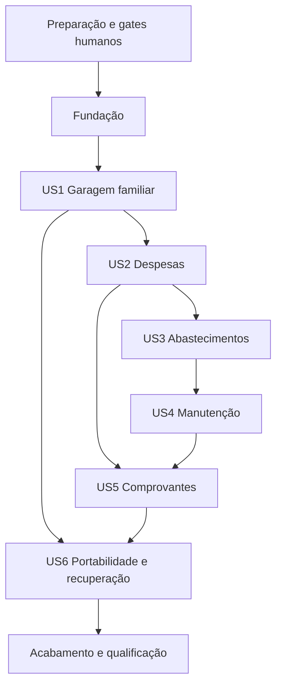

# Tarefas: Garagem pessoal e familiar

**Entrada**: Documentos em `specs/001-garagem-pessoal/`.
**Pré-requisitos**: [spec](spec.md), [plano](plan.md), [pesquisa](research.md), [modelo](data-model.md), [OpenAPI](contracts/openapi.json), [regras HTTP/mobile](contracts/api.md) e [quickstart](quickstart.md).
**Origem**: IA assistida. **Revisor humano**: CEO da Altivy e owner do GarageMotor.
**Estado**: tarefas propostas; nenhuma implementação autorizada ou validada.
**Seleção explícita**: `SPECIFY_FEATURE_DIRECTORY=specs/001-garagem-pessoal`.

## Formato: `[ID] [P?] [Story] Descrição`

IDs são sequenciais; `[P]` identifica arquivos distintos e ausência de dependência mútua depois dos gates da fase. `[US1]`–`[US6]` relacionam tarefas às histórias. Referências FR/SC indicam rastreabilidade, não evidência de execução. Marcar checkbox somente após validação executada, nunca como aprovação humana.

## Convenções de Caminhos

Usar a estrutura enxuta do plano: `backend/GarageMotor.Api/`, `backend/GarageMotor.Tests/`, `frontend/web/`, `frontend/tests/`, `deploy/`, `tools/scripts/` e `docs/`. Os caminhos abaixo são destinos de implementação futura, não arquivos já existentes. Não criar scripts próprios em `.specify/` nem copiar agentes, Keycloak, terminal ou Business do Dokpod.

## Fase 1: Preparação (Infraestrutura Compartilhada)

**Objetivo**: registrar os gates humanos e preparar código, contratos e ferramentas auditados.
**Bloqueio**: antes de executar qualquer tarefa, concluir `/speckit-analyze` e obter autorização humana explícita sobre diretório, tarefas e escopo. Nenhuma tarefa autoriza push, publicação, release ou aceite automático de termos.

- [ ] T001 Registrar revisão e decisão humana do datastore em `docs/adr/2026-0001-persistencia-garagem.md` e gates de segurança em `docs/security-review.md`; não marcar ADR accepted sem evidência humana; ausência de decisão bloqueia T005 e toda persistência.
- [ ] T002 Formalizar texto oficial AGPL-3.0-only em `LICENSE`, avisos em `NOTICE.md` e reconciliação da referência MIT em `.github/copilot-instructions.md`/`README.md`, preservando histórico, terceiros e a exceção restrita Android; auditar primeiro gestão Altivy.Groundwork, sem alterar templates ou procedimentos por cópia automática.
- [ ] T003 Inventariar versões/licenças/origem/hashes diretos e transitivos em `docs/dependencies.md`, `global.json`, `backend/Directory.Packages.props` e `frontend/web/package.json`; usar SDK 10.0.403/runtime 10.0.14, Npgsql 10.0.3, MSTest 4.5.2, Angular 22.2.5/CLI-build 22.2.6, TS 6.0.3/Node 24.22.2, Capacitor 8.6.0, Playwright 1.65.0 e Prettier 3.9.10; resolver lockfiles sem scripts e falhar fechado antes de instalar pacote com licença ausente/restritiva.
- [ ] T004 Fixar manifests de imagens/termos/checksums em `deploy/images.lock.json` e `docs/android-toolchain.md`: PostgreSQL 18.6/nginx 1.30.6; JDK 21.0.13+9, Gradle 8.14.3, AGP 8.13.0 e Android build-tools 36.0.0; obter aceites humanos necessários antes de uso; nenhuma ferramenta Android no host ou distribuída no app.
- [ ] T005 Criar os dois projetos .NET em `backend/GarageMotor.Api/GarageMotor.Api.csproj` e `backend/GarageMotor.Tests/GarageMotor.Tests.csproj`, SPA em `frontend/web/angular.json`/`frontend/web/tsconfig.json` e lockfiles auditados em `backend/GarageMotor.Api/packages.lock.json`, `backend/GarageMotor.Tests/packages.lock.json` e `frontend/web/package-lock.json`; depender de T001–T004, sem ORM/mediator/framework UI adicional.
- [ ] T006 Configurar formatador/analyzers e compilação estrita em `backend/Directory.Build.props`, `.editorconfig` e `frontend/web/.prettierrc.json`; preservar arquivos fora do escopo e expor verificações pelo runner de qualidade em containers.
- [ ] T007 Preparar `deploy/compose.yaml`, `deploy/nginx.conf` e `tools/scripts/start-local.ps1`/`stop-local.ps1`: API, web, banco e volume privados, somente nginx como borda HTTP; encaminhar também preview Angular pelo proxy; passar apenas caminho externo de secrets, sem copiar/exibir conteúdo; parada não remove volumes implicitamente.
- [ ] T008 Preparar runners e fixtures fictícias em `tools/scripts/validate-feature.ps1`, `backend/GarageMotor.Tests/Fixtures/RealEnvironment.cs` e `frontend/tests/playwright.config.ts`; perfis quality/unit/integration/web-e2e/android/load/restore, exit codes e resumos sanitizados; banco/filesystem reais, HTTP pelo nginx e unit sem nginx ocioso.

**Checkpoint**: somente após inventário, termos, autorização e estrutura validados, iniciar a fundação. T001 não é aprovação delegada à IA; T003/T004 não se concluem por citar licença primária no plano.

## Fase 2: Fundação (Pré-requisitos Bloqueadores)

**Objetivo**: identidade, contexto de garagem, transações, partições, erros e primitivas UI.
**CRÍTICO**: nenhuma história de usuário pode começar antes da conclusão desta fase.

- [ ] T009 [P] Escrever testes de fundação em `backend/GarageMotor.Tests/Foundation/SecurityTests.cs` para sessão/revogação, CSRF/origem, respostas genéricas e ausência de secrets; testes devem falhar para comportamento ausente, sem mocks como evidência de persistência.
- [ ] T010 [P] Escrever testes PostgreSQL/arquivo de base em `backend/GarageMotor.Tests/Foundation/PersistenceTests.cs`: transações, dois contextos sintéticos de garagem em tabela de fixture, conexões pooled, RLS, role sem BYPASSRLS, mecanismo de lock/rollover e índices/default; banco/filesystem reais, sem depender das entidades ainda não criadas em US1; produção com membership/recibos reais é revalidada em T021/T028/T034/T064.
- [ ] T011 [P] Escrever validação de contrato em `frontend/tests/contracts/openapi.spec.ts` e teclado/foco/estados do DS em `frontend/tests/design-system.spec.ts`; respeitar o OpenAPI atual e comparar schemas/DTOs de resposta sem relaxar contrato por teste.
- [ ] T012 Implementar infraestrutura SQL/transações/migrations expand-contract em `backend/GarageMotor.Api/Infrastructure/Database.cs` e `backend/GarageMotor.Api/Migrations/001_identity_and_operations.sql`: UUID/version positiva, datas UTC, role runtime sem superuser/BYPASSRLS, SET LOCAL por transação e role migrations separada; aplicar RLS às tabelas de domínio quando criadas.
- [ ] T013 Implementar preparação/rollover em `backend/GarageMotor.Api/Infrastructure/PartitionManager.cs`: partições mensais, doze meses anteriores/três futuros/default, job diário, migração transacional do default antes de attach e índices por filho; não presumir unicidade/FK global entre partições; fundação expõe mecanismo, migrations das entidades pertencem às histórias.
- [ ] T014 Implementar transações de operação e concorrência em `backend/GarageMotor.Api/Operations/OperationStore.cs`: UUID de chave, request_hash e resposta mínima, retenção enquanto garagem existe, lock transacional/busca entre partições, replay reautorizado e 409 para payload/versão divergentes; If-Match inteiro positivo entre aspas.
- [ ] T015 Implementar auditoria e contratos de falha em `backend/GarageMotor.Api/Operations/AuditStore.cs` e `backend/GarageMotor.Api/Infrastructure/ProblemResponses.cs`: 90 dias, partições mensais, actor pseudônimo/campos alterados mínimos e traceId, sem valores/documentos/tokens/logs integrais; problem+json para 400/401/403/404/409/413/415/422/429/503 e sem enumeração cruzada.
- [ ] T016 Implementar modelos/store de identidade em `backend/GarageMotor.Api/Identity/IdentityStore.cs`: email normalizado até 254/nome até 100, active/disabled, password_hash pelo framework, sessão opaca de pelo menos 256 bits com apenas hash persistido e expiração de 12 horas, códigos de recuperação uso único com expires_utc/consumed_utc; não criar criptografia própria ou bypass público.
- [ ] T017 Implementar endpoints/middleware de identidade em `backend/GarageMotor.Api/Identity/IdentityEndpoints.cs`: registerAccount/createSession/revokeSession/getCsrfToken/requestRecovery/confirmRecovery/renewOfflineRecoveryCodes, senha 12–128, cookie web Secure/HttpOnly/Path=/, antiforgery/CORS/rate limit e bearer opaco Android; códigos offline revelados uma vez após reautenticação, SMTP opcional e revogação de sessões após recuperação.
- [ ] T018 Implementar proteção/configuração em `backend/GarageMotor.Api/Infrastructure/SecurityConfiguration.cs`, `frontend/web/src/app/core/session.ts` e telas em `frontend/web/src/app/features/auth/`: cadastro/login/logout/recuperação, códigos offline somente após reautenticação, chaves do framework protegidas por credencial externa em volume privado, nenhum segredo plaintext no repo/exportação, token web fora do JavaScript, estado Android em memória até Keystore de US6; nenhum localStorage de token.
- [ ] T019 Implementar shell/tokens/primitivas necessárias em `frontend/web/src/app/design-system/` e `frontend/web/src/styles/`: usar referência Altivy/Dokpod autorizada, Outfit com avisos próprios, painéis densos opacos, foco/teclado/status texto-ícone/motion reduzido; sem importar Business, Ionic UI, axe-core/MPL ou biblioteca não auditada.
- [ ] T020 Integrar infraestrutura, autenticação e informações públicas em `backend/GarageMotor.Api/Program.cs`, `backend/GarageMotor.Api/Operations/InstanceEndpoints.cs` e `frontend/web/src/app/core/api-client.ts`: base /api/v1, getInstance major1, requests tipados, erros recuperáveis, cabeçalhos e indicadores como strings decimais; validar T009–T011 e perfis unit/integration/quality.

**Checkpoint**: T009–T020 validadas com backend real, contratos, contexto e UI de base. A membership específica será implementada em US1; nenhuma história pode contorná-la usando mocks ou identidade administrativa global.

## Fase 3: História de Usuário 1 - Garagem familiar (Prioridade: P1) MVP

**Objetivo**: garagem, veículos, compartilhamento e isolamento.
**Teste independente**: duas garagens com veículos, convite/papéis/revogação e último owner protegido, sem despesas.

### Testes da História de Usuário 1

- [ ] T021 [P] [US1] Testar FR-002–FR-005/SC-003 em `backend/GarageMotor.Tests/Garages/GarageTests.cs`: convites 72h/uso único/email correspondente, proprietário/editor/leitor, transferência atômica, recurso cruzado 404, veículo arquivado e membro revogado.
- [ ] T022 [P] [US1] Testar jornada inicial e teclado em `frontend/tests/garage.spec.ts`: login, criação/seleção de garagem, convite/aceite/papéis e cadastro/arquivo de carro/moto; anexar screenshots desktop/mobile e confirmar falha antes da UI.

### Implementação da História de Usuário 1

- [ ] T023 [US1] Criar modelos/migration/store em `backend/GarageMotor.Api/Garages/GarageStore.cs` e `backend/GarageMotor.Api/Migrations/002_garages_vehicles.sql`: Garage name1–100/fuso IANA America/Sao_Paulo/active-deleting; Member owner-editor-reader/active-revoked e unicidade garagem-usuário; Invite email até254/role editor-reader/pending-accepted-revoked-expired/hash/72h; UUID/version e owner único com transferência atômica.
- [ ] T024 [US1] Implementar veículo em `backend/GarageMotor.Api/Vehicles/VehicleStore.cs`: label/brand/model1–100, car/motorcycle, year1900–ano atual+1, fuel gasoline-ethanol-diesel-flex-electric-other, plate opcional até10/renavam opcional11dígitos/chassis opcional até17, active/archived; arquivar preserva histórico e recusa novos registros.
- [ ] T025 [US1] Implementar `backend/GarageMotor.Api/Garages/GarageEndpoints.cs` e `backend/GarageMotor.Api/Vehicles/VehicleEndpoints.cs`: create/list/get/updateGarage, members/roles/revogação/ownership/invites/aceite e create/list/get/updateVehicle; membership por operação, RLS/contexto de garagem e If-Match; exclusão de garagem delegada ao job US6 sem exclusão direta neste incremento.
- [ ] T026 [US1] Implementar telas e seleção em `frontend/web/src/app/features/garages/` e `frontend/web/src/app/features/vehicles/`, rotas/guards em `frontend/web/src/app/app.routes.ts`; aplicar pt-BR e states vazios/arquivados, validação e permissão sem expor outra garagem.
- [ ] T027 [US1] Validar T021–T026 pelos perfis de `tools/scripts/validate-feature.ps1`, registrando resultados sanitizados em `docs/verification/us1.md`; reautorizar convites/replay/membership, teclado e fluxo com nginx; não marcar execução com base apenas em mocks ou screenshots.

**Checkpoint**: US1 entrega primeiro incremento demonstrável, mas não o MVP completo da spec.

## Fase 4: História de Usuário 2 - Despesas e custos (Prioridade: P1)

**Objetivo**: fonte única de despesas, totais corretos e cobertura explícita.
**Teste independente**: fixture US1 e três despesas; correção/anulação, totais e distância insuficiente.

### Testes da História de Usuário 2

- [ ] T028 [P] [US2] Testar FR-006–FR-009/FR-013/SC-002–SC-004 em `backend/GarageMotor.Tests/Expenses/ExpenseTests.cs`: centavos exatos, transação, anulação, alteração de data/partição, conflito e chave repetida; custo/km não completo sem intervalo/distância.
- [ ] T029 [P] [US2] Testar tabela/filtros/registro/correção/anulação/totais em `frontend/tests/expenses.spec.ts`, incluindo estados vazios, leitor, formato pt-BR e cobertura parcial; usar dados autorizados pelo nginx.

### Implementação da História de Usuário 2

- [ ] T030 [US2] Criar entidade/migration/store em `backend/GarageMotor.Api/Expenses/ExpenseStore.cs` e `backend/GarageMotor.Api/Migrations/003_expenses.sql`: vehicle/garage/date obrigatórios, description1–500, amount_minor1–999.999.999.999 BRL, category fuel-maintenance-insurance-tax-other, origin manual-fuel-maintenance com vínculo opcional, active/voided e autoria/version; partição mensal spent_on, chave(id,spent_on,garage_id) e relações com mesma garagem.
- [ ] T031 [US2] Implementar contratos e agregação em `backend/GarageMotor.Api/Expenses/ExpenseEndpoints.cs` e `backend/GarageMotor.Api/Expenses/SummaryService.cs`: list/create/update/voidExpense/getSummary, filtros inclusivos from/to/veículo, página50/máximo100/cursor validado, coveredFrom/coveredTo/distanceKm/coveredExpenseMinor; decimal em strings e nenhum total duplicado; consumo fica indisponível até US3.
- [ ] T032 [US2] Implementar formulário/tabela/totais em `frontend/web/src/app/features/expenses/` e `frontend/web/src/app/features/dashboard/`, usando apenas DTOs públicos, filtros e permissões; não implementar fonte de despesas paralela ao contrato.
- [ ] T033 [US2] Validar T028–T032 em `docs/verification/us2.md` pelo runner, incluindo rollback de data financeira com referências e preservação de auditoria; medir a jornada inicial SC-001 em até cinco minutos com usuário preparado, sem presumir estudo de satisfação.

**Checkpoint**: despesas e totais são úteis mesmo sem consumo; indicadores incompletos não são apresentados como medição válida.

## Fase 5: História de Usuário 3 - Abastecimento e consumo (Prioridade: P1)

**Objetivo**: medição confiável e despesa de combustível única.
**Teste independente**: fixture US1 e sequência completa/parcial/corrigida de abastecimento.

### Testes da História de Usuário 3

- [ ] T034 [P] [US3] Testar FR-010–FR-013/SC-002–SC-004 em `backend/GarageMotor.Tests/Fuel/FuelTests.cs`: 100.000/100.550km e tanque final50L=11km/l, soma de parciais, combustíveis distintos, divisão zero, regressão/justificativa e recálculo.
- [ ] T035 [P] [US3] Testar criação/histórico/correção e repetição após reconexão em `frontend/tests/fuel.spec.ts`, sem duplicar valor/medição ou converter falta de fechamento em consumo completo.

### Implementação da História de Usuário 3

- [ ] T036 [US3] Implementar modelo/migration/store em `backend/GarageMotor.Api/Fuel/FuelStore.cs` e `backend/GarageMotor.Api/Migrations/004_fuel.sql`: odometer_km0–9.999.999, volume_ml1–1.000.000, fuel gasoline-ethanol-diesel-other, full_tank boolean, station opcional até200/historical_reason opcional até500, expense_id/date e active/voided/version; gravação/correção/anulação atômicas com US2 e partição mensal occurred_on.
- [ ] T037 [US3] Implementar `backend/GarageMotor.Api/Fuel/FuelEndpoints.cs` e `backend/GarageMotor.Api/Fuel/ConsumptionService.cs`: list/create/update/voidFuelRecord, intervalos completos com volume que recompõe tanque, parciais acumulados, combustível comparável e leitura válida com data; integrar getSummary sem sobrescrever a última leitura por inserção histórica silenciosa.
- [ ] T038 [US3] Implementar registro e histórico em `frontend/web/src/app/features/fuel/`, com tanque cheio, combustível, justificativa e cobertura; chave de operação estável/If-Match, limites em litros/km/BRL apresentados em pt-BR.
- [ ] T039 [US3] Validar T034–T038 com PostgreSQL real em `docs/verification/us3.md`, incluindo replay após rollover, conflito/recalculo e despesa única no dashboard; não marcar consumo correto por apenas comparar a aritmética do exemplo.

**Checkpoint**: fonte válida de odômetros/consumo, sem estimativa mecânica ou duplicação financeira.

## Fase 6: História de Usuário 4 - Manutenção e compromissos (Prioridade: P2)

**Objetivo**: planos, execução, lembretes e origem única do custo.
**Teste independente**: fixture com veículo/última leitura, plano por data e por km; concluir e conferir recorrência/custo.

### Testes da História de Usuário 4

- [ ] T040 [P] [US4] Testar FR-014–FR-017/SC-002 em `backend/GarageMotor.Tests/Maintenance/MaintenanceTests.cs`: vence por primeiro limite, proximidade30dias/500km, leitura defasada, conclusão repetida, custo único e próximo ciclo da conclusão.
- [ ] T041 [P] [US4] Testar manutenção/compromissos/lembretes em `frontend/tests/maintenance.spec.ts`, incluindo texto/ícone de estado, datas do fuso, mês limite e ausência de push/IA.

### Implementação da História de Usuário 4

- [ ] T042 [US4] Implementar entidades/migration/store em `backend/GarageMotor.Api/Maintenance/MaintenanceStore.cs` e `backend/GarageMotor.Api/Migrations/005_maintenance.sql`: Maintenance preventive/corrective/description1–500/completed_on/odometer/expense-id-date opcionais/plan-id opcional; Plan title1–200/due_on ou due_km não nulos/interval_months1–120 e interval_km1–1.000.000 opcionais/active-paused-completed; Commitment insurance-licensing-inspection-other/active-completed-cancelled, limites/recorrência/version; contexto e referências sempre da mesma garagem.
- [ ] T043 [US4] Implementar endpoints/regras em `backend/GarageMotor.Api/Maintenance/MaintenanceEndpoints.cs` e `backend/GarageMotor.Api/Maintenance/ReminderService.cs`: maintenance, plans, commitments, completeCommitment e listReminders conforme OpenAPI; apenas data/km conhecidos, versão/idempotência em conclusão, recorrência/dispesa transacional e lembretes in-app.
- [ ] T044 [US4] Implementar telas em `frontend/web/src/app/features/maintenance/` e `frontend/web/src/app/features/reminders/` com critérios explícitos e data da última leitura, sem apresentar previsão mecânica ou vencimento estimado como fato.
- [ ] T045 [US4] Validar T040–T044 em `docs/verification/us4.md`, incluindo mudança de fuso/mês, cancelamento, replay e integração da despesa com US2, sem regressão de US1–US3.

**Checkpoint**: manutenção e lembretes úteis sem serviço de push ou dados previstos.

## Fase 7: História de Usuário 5 - Comprovantes (Prioridade: P2)

**Objetivo**: evidência privada, íntegra e conferível ligada ao registro correto.
**Teste independente**: despesa/manutenção fictícia, três tipos válidos e casos inválidos, com volume/filesystem real.

### Testes da História de Usuário 5

- [ ] T046 [P] [US5] Testar FR-018–FR-020/SC-003–SC-004 em `backend/GarageMotor.Tests/Documents/DocumentTests.cs`: PDF/JPEG/PNG, cinco arquivos/10MiB, path malicioso, tipo/tamanho inválidos, pai de outra garagem, falha entre disco/banco, acesso revogado e reconciliação sem perda; usar filesystem real.
- [ ] T047 [P] [US5] Testar upload/download/remoção em `frontend/tests/documents.spec.ts`, limites e permissões, conteúdo byte-a-byte e headers attachment/nosniff; arquivo pendente não aparece como sucesso.

### Implementação da História de Usuário 5

- [ ] T048 [US5] Criar entidade/migration/store em `backend/GarageMotor.Api/Documents/DocumentStore.cs` e `backend/GarageMotor.Api/Migrations/006_documents.sql`: parent_kind expense/maintenance e id/data quando financeira, original_name até255, media_type PDF/JPEG/PNG, size_bytes1–10.485.760, sha256, storage_key opaca do servidor, pending/ready/deleting e version; limite cinco por pai sob bloqueio transacional.
- [ ] T049 [US5] Implementar staging, validação e endpoints em `backend/GarageMotor.Api/Documents/DocumentEndpoints.cs` e `backend/GarageMotor.Api/Documents/PrivateFileStore.cs`: create/download/deleteAttachment, paths normalizados/autorizados, limite/type/conteúdo, autorizar toda recuperação, sem caminho original/execução inline; não anunciar validação de tipo como antivírus.
- [ ] T050 [US5] Implementar reconciliação em `backend/GarageMotor.Api/Documents/FileReconciler.cs`: staging órfão24h, ready/deleting/vínculos verificados, retry idempotente e coleta sem excluir arquivo ainda referenciado; registrar só resumo técnico mínimo.
- [ ] T051 [US5] Implementar comprovantes em `frontend/web/src/app/features/documents/`, integração com despesas/manutenção, estados pendentes/falha recuperável e download protegido, sem URLs públicas ou plugin não auditado.
- [ ] T052 [US5] Validar T046–T051 em `docs/verification/us5.md` com volume real, falha parcial/race limite/revogação e integridade; preparar fixtures de arquivo para US6 sem usar documentos pessoais.

**Checkpoint**: comprovantes corretos e privados, com fundamento de restauração consistente.

## Fase 8: História de Usuário 6 - Web, Android e dados próprios (Prioridade: P1)

**Objetivo**: portabilidade, instalação independente, exportação/backup e continuidade.
**Ordem**: prioridade P1 preservada; o aceite completo depende de US1–US5, por isso esta fase integra no final. Preparação de toolchain ocorre em T004 e testes Android podem usar fixtures antes, sem chamar o MVP completo de concluído.
**Teste independente**: fixture completa numa instalação isolada, Android API35/36 e restauração em destino vazio, sem SaaS/IA/push/licença online.

### Testes da História de Usuário 6

- [ ] T053 [P] [US6] Testar FR-021–FR-024/FR-027/SC-006/SC-008 em `backend/GarageMotor.Tests/Operations/RecoveryTests.cs`: export owner/revogação/expiração, backup consistente, checksums/cópia corrompida/destino existente, exclusão30dias e ausência de credenciais; banco e arquivos reais.
- [ ] T054 [P] [US6] Testar seleção de instância e rede em `frontend/tests/instance.spec.ts`: major/TLS válidos, inválidos sem bypass, troca encerra sessão/limpa dados, gravação desconectada sem sucesso falso e replay da mesma chave após reconexão.
- [ ] T055 [P] [US6] Preparar testes Android em `frontend/web/android/app/src/androidTest/` e orquestração em `tools/scripts/test-android.ps1`: API35/36/WebView mantido, seis jornadas, Keystore, revogação e mudança de instância; testar via borda nginx, sem licença SaaS/execução host/publicação.

### Implementação da História de Usuário 6

- [ ] T056 [US6] Implementar ExportJob/GarageDeletion em `backend/GarageMotor.Api/Operations/ExportStore.cs` e `backend/GarageMotor.Api/Migrations/007_exports_deletion.sql`: job pending-running-ready-failed-expired, owner_id/created/expires e arquivo/checksum, exportação24h; exclusão requested-running-completed-failed, deadline até30dias, sem afetar outras garagens ou incluir hashes/credenciais.
- [ ] T057 [US6] Implementar worker/endpoints em `backend/GarageMotor.Api/Operations/ExportEndpoints.cs` e `backend/GarageMotor.Api/Operations/ExportWorker.cs`: create/get/downloadExport, requestGarageDeletion de US1, owner reautorizado, manifesto/arquivos e atualização transacional, sem broker ou shell remoto; coleta ativa e retenção/backups conforme contrato.
- [ ] T058 [US6] Implementar snapshot/restore em `tools/scripts/backup.ps1` e `tools/scripts/restore.ps1`: containers, pausar escritas/drenar arquivos, banco+volume consistentes/checksums, destino vazio/falha fechada e origem preservada; sem ler/exibir arquivo externo de secrets ou copiar credenciais no backup.
- [ ] T059 [US6] Configurar Capacitor8.6.0 e app nativo em `frontend/web/capacitor.config.ts` e `frontend/web/android/`: assets do mesmo build Angular22, pacote versionado, target/compileAPI36/Gradle8.14.3/AGP8.13.0/JDK21.0.13+9 conforme T004, política TLS e Keystore/APIs da plataforma; sem plugin de token não auditado ou build fora de container.
- [ ] T060 [US6] Implementar seleção/conexão e operações em `frontend/web/src/app/features/instance/`, `frontend/web/src/app/features/operations/` e `frontend/web/src/app/core/android-session.ts`: major compatível, sessão separada, autenticação nova ao trocar, dados privados/estado em memória, exportação/exclusão confirmadas e termos de retenção legíveis.
- [ ] T061 [US6] Empacotar aplicação e instalação em `deploy/Dockerfile.api`, `deploy/Dockerfile.web`, `deploy/Dockerfile.android`, `tools/scripts/package-local.ps1` e `docs/install.md`: imagens auditadas/digests, serviços/volumes privados, proxy nginx, fonte/avisos e configuração externa; produzir artefatos locais, sem push, loja ou release pública.
- [ ] T062 [US6] Validar T053–T061 em `docs/verification/us6.md`: seis jornadas web/Android na matriz, instalação limpa sem SaaS/IA/push/chave, recuperação100% e falhas/replay; assinatura/termos necessários têm evidência humana, não aceite automático.

**Checkpoint**: núcleo completo conectado, self-hosted e Android qualificados localmente; publicar é decisão separada.

## Fase 9: Acabamento e Aspectos Transversais

**Objetivo**: evidências de desempenho, segurança, formato/build e operação antes de promoção.

- [ ] T063 [P] Criar carga SC-005 em `backend/GarageMotor.Tests/Performance/HistoryLoadTests.cs`: 10 usuários simultâneos/10.000 registros/matriz4vCPU-8GiB-SSD/P95<=2s, dados fictícios e leitura pelo nginx; registrar resultado real, não garantia universal.
- [ ] T064 [P] Criar qualificação de partições/retenção em `backend/GarageMotor.Tests/Operations/PartitionRetentionTests.cs`: doze meses anteriores/três futuros/default, attach seguro, índices por filho, concorrência/replay após rollover, auditoria90dias e nenhum drop de histórico financeiro por idade ou de outra garagem.
- [ ] T065 [P] Criar smoke/compatibilidade em `frontend/tests/smoke.spec.ts` e `tools/scripts/test-images.ps1`: imagem runtime, instalação própria, versão API/cliente compatível, serviços internos sem borda pública e upgrade/rollback expand-contract sem perda de dados.
- [ ] T066 [P] Auditar acessibilidade e visual em `frontend/tests/accessibility.spec.ts` e `docs/accessibility-review.md`: Chromium/Firefox/WebKit, 1280x800/390x844, teclado/foco/labels/estados texto-ícone/motion reduzido sem sobreposição; checks automatizáveis mais revisão humana WCAG2.2AA, sem alegar certificação por Playwright sozinho.
- [ ] T067 Consolidar revisão de segurança em `docs/security-review.md` com evidências de IDOR/RLS/CSRF/recuperação/tokens/arquivos/backup/TLS e privacidade; obter revisão humana das superfícies privilegiadas, resolver achados relevantes e não declarar aprovação sem referência.
- [ ] T068 Executar formatador/análise estática/build/testes do recorte por `tools/scripts/validate-feature.ps1`, perfis quality/unit/integration/web-e2e/android/load/restore e smoke; registrar resultados sanitizados em `docs/verification/final.md`, sem logs integrais, secrets ou testes de HTTP fora do nginx.
- [ ] T069 Atualizar matriz e operação em `README.md`, `docs/install.md`, `docs/operations.md` e `specs/001-garagem-pessoal/quickstart.md` com comandos implementados/pré-requisitos/impacto, sinais/mitigação/recuperação/escalonamento, versões/capacidade/retensão e limites; não apresentar roteiro não executado como validado.
- [ ] T070 Revisar cobertura/execução em `specs/001-garagem-pessoal/tasks.md`, inventário/avisos e relatório final em `docs/verification/final.md`; executar `/speckit-converge` após implementação autorizada, sem executar automaticamente tarefas novas; manter preços, publicação e iOS fora do escopo.

## Dependências e Ordem de Execução

### Dependências entre Fases

Preparação T001–T008 -> Fundação T009–T020 -> US1 T021–T027. Testes de fundação T009/T010/T011 podem ser escritos em paralelo após os runners, mas sua execução com stack real depende de T012–T020. Cada teste é criado e demonstra falha antes da implementação correspondente; retries/checagens não podem ser pulados por conveniência.

US2/US3/US4/US5 usam a fixture US1; código financeiro compartilha a despesa de US2. US3 e US4 integram após US2; US4 usa leitura válida de US3. US5 integra despesas/manutenção. US6 é P1 e termina após US1–US5 pela exigência de validar o mesmo núcleo completo no Android e recuperar todos os vínculos.

Acabamento T063–T070 depende das histórias. T063/T064/T065/T066 podem ser preparados em arquivos distintos após US6; T067 recebe suas evidências, T068 é gate final, T069/T070 consolidam os resultados. Não confundir ID sequencial com autorização para ignorar dependências ou testes.

### Dependências entre Histórias

### Dentro de Cada História

Testes -> modelos/migration/store -> serviços/endpoints -> UI -> validação real e checkpoint. Testes independentes podem usar fixtures de histórias predecessoras sem exigir que a jornada predecessora seja repetida em cada caso. Nenhuma fixture autoriza acesso administrativo global que contorne membership/RLS.

### Oportunidades de Paralelismo

Marcadores [P] somente em testes/qualificação de arquivos distintos. Não paralelizar migrations/stores que compartilham origem financeira, Program.cs, routes, contrato, lockfile ou pipeline; integrar após validação focada. Jobs de partições e exportação devem respeitar exclusão/restauração para não escrever durante manutenção.

## Exemplos de Paralelismo por História

| História | Tarefas independentes após seus pré-requisitos | Condição |
|---|---|---|
| US1 | T021 / T022 | Runners/fundação; testes em arquivos distintos |
| US2 | T028 / T029 | Fixture US1 e contrato atual |
| US3 | T034 / T035 | Fonte de despesas US2 e fixture de abastecimentos |
| US4 | T040 / T041 | US2/US3 e regras de limites |
| US5 | T046 / T047 | Pais financeiros/volume da stack |
| US6 | T053 / T054 / T055 | Fixture completa, toolchain/termos e imagens auditados |

Não executar delegação/implementação apenas porque existe marcador [P]; a autorização de escopo continua humana.

## Estratégia de Implementação

### MVP Primeiro (Somente História de Usuário 1)

Preparação, fundação e US1 entregam primeiro incremento demonstrável de garagem/compartilhamento. Parar e validar US1 antes de despesas. Isso não cumpre sozinho a primeira entrega completa definida na spec, que inclui US1–US6 e Android/self-hosted.

### Entrega Incremental

Adicionar despesas, abastecimentos, manutenção e comprovantes com checkpoints reais. Qualificar Android/instância própria/exportação/restauração após o núcleo completo. Desempenho, segurança, acessibilidade e smoke são gates finais; nenhuma fase autoriza release automaticamente.

### Estratégia para Trabalho em Paralelo

Separar autores apenas em tarefas [P] sem dependência/confito de arquivo. Runner compartilhado, banco/volumes e recursos de teste devem ser isolados por execução. Gates humanos T001/T004/T067 são aguardados, não preenchidos pelo agente.

## Rastreabilidade

| Requisito | Tarefas principais |
|---|---|
| FR-001 | T009, T016, T017, T018 |
| FR-002 | T021, T023, T025, T026 |
| FR-003 | T021, T023, T025, T026 |
| FR-004 | T010, T012, T021, T025, T046, T053 |
| FR-005 | T021, T024, T025, T026 |
| FR-006 | T028, T030, T031, T032 |
| FR-007 | T028, T030, T031, T033 |
| FR-008 | T028, T031, T032, T039, T045 |
| FR-009 | T028, T031, T037 |
| FR-010 | T034, T036, T037, T038 |
| FR-011 | T034, T037, T039 |
| FR-012 | T034, T036, T037, T039 |
| FR-013 | T010, T014, T028, T034, T036, T043, T049 |
| FR-014 | T040, T042, T043, T045 |
| FR-015 | T040, T042, T043, T044 |
| FR-016 | T040, T043, T044, T045 |
| FR-017 | T041, T043, T044 |
| FR-018 | T046, T048, T049, T051 |
| FR-019 | T046, T049, T067 |
| FR-020 | T046, T049, T050, T052 |
| FR-021 | T054, T055, T059, T060, T062 |
| FR-022 | T020, T054, T059, T060, T065 |
| FR-023 | T053, T056, T057, T058, T062 |
| FR-024 | T053, T056, T057, T058, T060, T064 |
| FR-025 | T019, T026, T032, T038, T044, T060 |
| FR-026 | T011, T019, T022, T066 |
| FR-027 | T007, T054, T059, T061, T062 |
| FR-028 | T002, T003, T004, T061, T070 |
| FR-029 | T007, T008, T061, T063, T065, T069 |
| FR-030 | T010, T015, T067 |
| SC-001 | T022, T033 |
| SC-002 | T028, T034, T040, T068 |
| SC-003 | T010, T021, T046, T053, T067 |
| SC-004 | T010, T014, T028, T034, T046, T064 |
| SC-005 | T063, T068 |
| SC-006 | T053, T058, T062, T068 |
| SC-007 | T055, T062, T066, T068 |
| SC-008 | T002, T061, T062, T070 |

## Observações

- Snapshot do contrato lido nesta geração: SHA256 `1c7cf8f814eb1cc59b92b5a27248f48c3fa88b43ca7310b0476d24365c2d9c28`, 35 rotas/50 operações. O contrato não foi editado por `/speckit-tasks`; mudanças posteriores exigem reavaliar cobertura.
- Todos os campos/limites, estados e regras não repetidos integralmente nos nomes das tarefas são definidos no modelo/contrato referenciados. Não inventar valores ou relaxar validações durante execução; ambiguidades relevantes devem ser encaminhadas à revisão antes de implementar.
- Todas as tarefas começam desmarcadas. Checklist do documento ou cobertura estrutural não é evidência de implementação ou aceite humano.
- Próxima fase é `/speckit-analyze`, somente leitura; a revisão humana decide o escopo autorizado de `/speckit-implement` depois de resolver achados impeditivos.